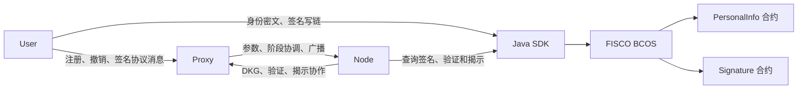
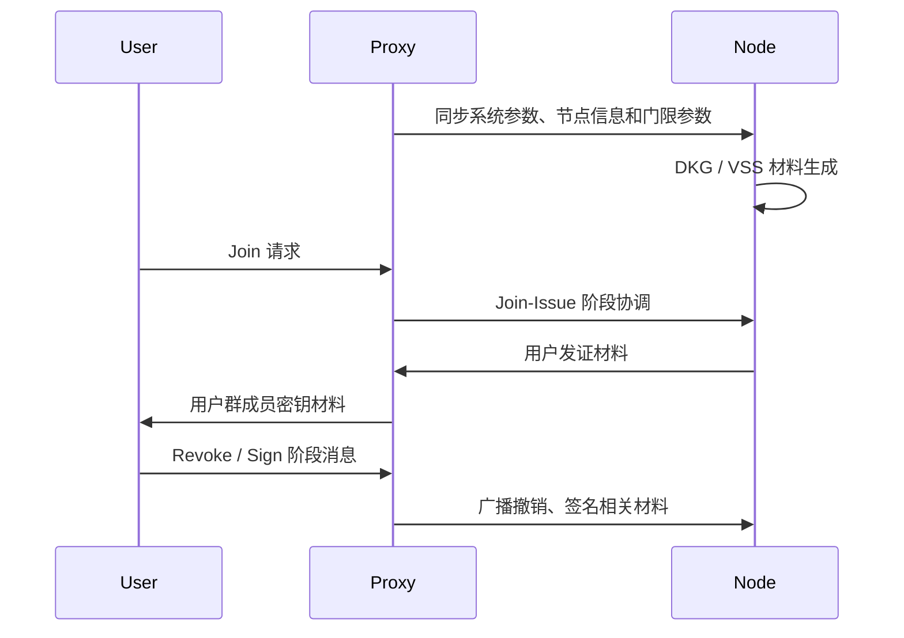
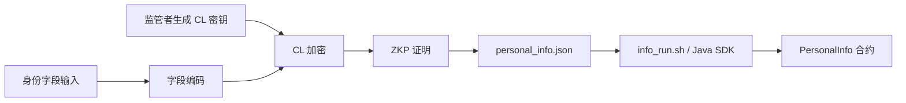
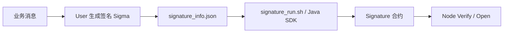
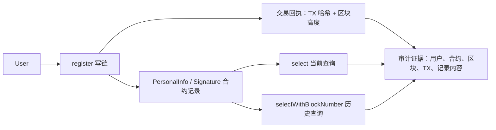

# 架构说明

系统由 Rust 协议角色、Java 链端应用和 FISCO BCOS 合约组成。下面按协议、身份字段、签名和审计查询说明它们之间的数据流。

## 角色

- User：持有用户私钥和身份字段，负责加入、签名、身份密文生成和链端写入。
- Proxy：维护系统参数、时间树、群公钥、用户和节点列表，是 User 与 Node 的协调入口。
- Node：多个节点共同完成 DKG、注册、撤销、验证和 Open。
- Java SDK：连接 FISCO BCOS，调用合约包装类。
- contracts：`PersonalInfo` 保存身份密文和证明材料，`Signature` 保存用户签名 JSON。

## 总体拓扑



## 协议控制流

三个角色的正式二进制入口复用 `intergration_test` 中的协议流程模块。当前默认拓扑是 1 个 Proxy、4 个 Node，配置最多支持 6 个 User：



## 身份字段加密数据流

身份字段处理由 `crates/id_info_process` 与 `crates/cl_encrypt` 完成。字段先编码，再由 CL 原生库加密；配套证明用于校验密文与明文承诺的一致性。



运行入口：

```bash
bash scripts/run-local/run-id-info.sh keygen
bash scripts/run-local/run-id-info.sh enc
```

链端接入点：

- Rust 侧读取 `GSTBK_PERSONAL_INFO_APP_DIR`。
- 该目录需要包含 `info_run.sh`。
- Java SDK 工程包含合约包装类和 `info_run.sh` 调用脚本。

## 签名上链数据流

签名数据由 User 生成，经 Rust 侧脚本调用链端应用写入 `Signature` 合约。Node 在 Verify 和 Open 阶段通过同一路径查询链上签名。



链端接入点：

- User 写链读取 `GSTBK_SIGNATURE_APP_DIR`，目录下需要有 `signature_run.sh`。
- Node 查询签名也读取 `GSTBK_SIGNATURE_APP_DIR`。
- `GSTBK_SIGNATURE_CONTRACT_ADDRESS` 指定部署后的签名合约地址。

## 审计追溯数据流

链上审计查询围绕 `PersonalInfo` 与 `Signature` 两类记录展开。User 写链后，Java SDK 会从交易回执中输出交易哈希和区块高度；后续监管方或 Node 可通过 `select` 查询当前记录，通过 `history` / `selectWithBlockNumber` 追溯指定区块时的历史记录。



当前可复核入口：

- `bash chain-apps/fisco-bcos-java-sdk/signature_run.sh select <contractAddress> <user>`
- `bash chain-apps/fisco-bcos-java-sdk/signature_run.sh history <contractAddress> <user> <blockNumber>`
- `bash chain-apps/fisco-bcos-java-sdk/info_run.sh select <contractAddress> <user>`
- `bash chain-apps/fisco-bcos-java-sdk/info_run.sh history <contractAddress> <user> <blockNumber>`
- `bash scripts/evidence/run-audit-query-demo.sh --manifest <manifest.json>`

查询命令和结果说明见[审计查询演示](evidence/audit-query-demo.md)。Open 根据本地注册表定位协议用户；监管者解密真实身份字段尚未接入此流程。

## Java SDK 与合约关系

`chain-apps/fisco-bcos-java-sdk` 使用 FISCO BCOS v3.6.0 Java SDK，包含生成后的合约包装类。部署和调用需要：

- `chain-apps/fisco-bcos-java-sdk/conf/config.toml`。
- 真实证书、账户和私钥材料。
- `GSTBK_PERSONAL_INFO_CONTRACT_ADDRESS` 与 `GSTBK_SIGNATURE_CONTRACT_ADDRESS`。

运行配置的准备方式见[配置与密钥管理](operations/secrets-and-config.md)。
